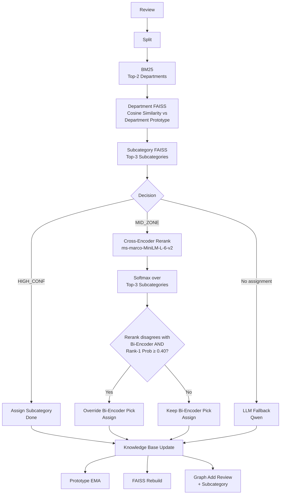

Readme · MD
# IntelliRoute
 
A live, traceable complaint-classification engine for streaming customer
feedback. Every review is split into atomic complaints and routed
through a five-stage pipeline — **BM25 → Dept FAISS → Sub FAISS →
Cross-Encoder Rerank → LLM fallback** — with a streaming trace and a
self-growing knowledge graph rendered in the React UI.
 
The bi-encoder stage picks candidates fast; the cross-encoder reranker
catches the close calls the bi-encoder gets wrong. The LLM is the last
resort, only invoked when retrieval confidence is genuinely low.
 
## Why this exists
 
A pure bi-encoder routes "food was too spicy and not taste good" to
**Temperature Issue** because lexical overlap (cold/ice/spicy) puts it
closer to the cold cluster than to the taste cluster. A cross-encoder
reads the words and disagrees: 0.815 softmax on **Taste & Quality**
versus 0.093 on Temperature Issue. The system now uses both, with the
cross-encoder only firing in the "middle zone" where the bi-encoder is
uncertain.

## Pipeline



Each stage records its scores into a `trace["stages"]` list that the
React `<TracePanel />` component renders as a live waterfall.

## Project layout

```
core/                               FastAPI — the classification pipeline
│   └── app/
│       ├── main.py                   API endpoints
│       ├── config.py                 thresholds, departments, model names
│       ├── embeddings.py             bi-encoder + cross-encoder + Groq LLM
│       ├── state.py                  in-memory KB / FAISS / graph
│       ├── search.py                 BM25 + FAISS search & rebuilds
│       ├── graph_store.py            graph mutation + JSON export
│       ├── pipeline.py               extract_issues, classify_issue_traced
│       ├── bootstrap.py              builds initial KB from 10 seed reviews
│       └── __init__.py
├── web/                              React + TypeScript (Vite) — console UI
│   └── src/
│       ├── main.tsx
│       ├── App.tsx
│       ├── api.ts                    fetch wrapper around /api/*
│       ├── index.css
│       └── components/
│           ├── graph-flow.tsx        live BM25 → FAISS → Rerank → LLM trace
│           ├── graph-kpi.tsx         metric cards and distribution charts
│           └── intelliroute/
│               ├── TracePanel.tsx    stage-by-stage inference trace
│               ├── KnowledgePanel.tsx knowledge-map treemap and review table
│               ├── CategoryIndex.tsx searchable taxonomy
│               └── NodeDrawer.tsx    department / category detail drawer
├── venv/                             Python virtualenv (created in install)
└── README.md
```

## Install

Requires Python 3.11–3.12 (the pinned `numpy==1.26.4` / `faiss-cpu==1.8.0`
have no Python 3.13 wheels) and Node 18+.

### 1. Backend

```bash
cd core
python -m venv ../venv                  # creates venv at project root
# Windows:
..\venv\Scripts\activate
# macOS / Linux:
source ../venv/bin/activate

pip install -r requirements.txt
cp .env.example .env                    # paste your GROQ_API_KEY
uvicorn app.main:app --reload --port 8000
```

If you use `uv`, `uv venv --python 3.11 ../venv` creates the 3.11 venv
without needing a system Python 3.11 install.

The first request triggers a one-time `bootstrap()` that builds the
initial knowledge base from 10 seed reviews via a single Groq call. Both
embedding models (`bge-small-en-v1.5` ~120MB, `ms-marco-MiniLM-L-6-v2`
~70MB) are downloaded lazily on first use.

You'll need a Groq API key for the LLM stages
(https://console.groq.com). The `.env` file is git-ignored.

### 2. Frontend

```bash
cd web
npm install
npm run dev
```

Opens on `http://localhost:5173`. Vite proxies `/api/*` to the backend
on port 8000 (see `vite.config.js`); no CORS configuration needed.

For a production build:

```bash
npm run build                           # outputs to web/dist/
```

## API

All endpoints are served by the FastAPI app on `http://localhost:8000`.

| Method | Path                  | Purpose                                              |
|--------|-----------------------|------------------------------------------------------|
| POST   | `/api/classify`       | One review → split + trace + new graph highlight     |
| POST   | `/api/classify_batch` | Many reviews, sequential, error-tolerant             |
| POST   | `/api/bootstrap`      | Force-run bootstrap (no-op if already done)          |
| POST   | `/api/reset`          | Wipe in-memory state back to empty                   |
| GET    | `/api/graph`          | Current knowledge graph as nodes/edges JSON          |
| GET    | `/api/stats`          | Counts (departments, sub-categories, reviews)        |
| GET    | `/health`             | Liveness check                                       |

`POST /api/classify` body: `{ "review": "...", "skip_split": false }`
where `skip_split=true` mirrors the notebook's
`visualize_inference(text, skip_split=True)` — use it when the input is
already one atomic complaint, to save one LLM call.

Response shape:
```json
{
  "review": "food was too spicy and not taste good",
  "issues": ["food was too spicy and not taste good"],
  "traces": [{
    "query": "food was too spicy and not taste good",
    "stages": [
      {"stage": "BM25",      "scores": {...}, "top2": [...]},
      {"stage": "Dept FAISS", "scores": {...}, "winner": "Food", "sim": 0.766},
      {"stage": "Sub FAISS",  "candidates": [...], "winner": "Temperature Issue",
       "sim": 0.709, "decision": "MID_ZONE", "margin": 0.017},
      {"stage": "Rerank",     "model": "cross-encoder/ms-marco-MiniLM-L-6-v2",
       "scores": [["Temperature Issue", 0.093], ["Taste & Quality", 0.815],
                  ["Undercooked Food", 0.092]],
       "winner": "Taste & Quality", "bi_encoder_winner": "Temperature Issue",
       "overrode": true}
    ],
    "result": {"department": "Food", "sub_category": "Taste & Quality", ...}
  }],
  "highlight": [...]
}
```

## Configuration

Everything you might want to tune lives in `core/app/config.py`.

| Constant                  | Default                              | Effect                                                          |
|---------------------------|--------------------------------------|-----------------------------------------------------------------|
| `DEPARTMENTS`             | 5 fixed departments                  | The high-level routing targets                                  |
| `HIGH_CONF`               | `0.85`                               | Above this cosine sim → assign directly, no rerank              |
| `LOW_CONF`                | `0.70`                               | Below this cosine sim → fall through to LLM                    |
| `RERANK_ENABLED`          | `True`                               | Master switch for the cross-encoder stage                       |
| `RERANK_MARGIN_THRESHOLD` | `0.05`                               | Skip rerank when bi-encoder top-1 wins by ≥ this margin         |
| `RERANK_OVERRIDE_PROB`    | `0.40`                               | Min softmax prob for the reranker to override bi-encoder        |
| `EMA_ALPHA`               | `0.10`                               | Prototype EMA update rate (smaller = more stable prototypes)    |
| `OUTLIER_THRESHOLD`       | `0.65`                               | Reviews below this similarity to prototype skip prototype update|
| `EMBEDDING_MODEL`         | `BAAI/bge-small-en-v1.5`             | Bi-encoder (384-dim, ~120MB)                                    |
| `CROSS_ENCODER_MODEL`     | `cross-encoder/ms-marco-MiniLM-L-6-v2` | Cross-encoder reranker (~70MB, lazy-loaded)                 |
| `LLM_MODEL`               | `qwen/qwen3.8-27b` (Groq)            | Used for issue splitting + LLM fallback                         |

The seed corpus in `INITIAL_REVIEWS` is what the bootstrap LLM call
classified into the initial sub-categories. To bootstrap from your own
corpus, replace it with a list of 20–50 representative reviews covering
each department.

## How routing actually decides

For each atomic complaint the pipeline tries, in order:

1. **BM25** — keyword overlap against the per-department corpus of
   known reviews. Picks the top-2 departments.
2. **Dept FAISS** — cosine sim between the query embedding and each
   candidate department's prototype vector. Picks the best.
3. **Sub FAISS** — cosine sim against the top-3 sub-categories inside
   the chosen department.
    - If best sim ≥ `HIGH_CONF` (0.85) **and** top-1 beats #2 by
      ≥ `RERANK_MARGIN_THRESHOLD` × 3 (0.15) → assign directly.
    - Otherwise → "MID_ZONE" → cross-encoder rerank fires.
4. **Cross-encoder rerank** — only fires inside the middle zone. Pairs
   the original query text with each candidate sub-category's
   *description*, softmaxes over the candidates, and **overrides** the
   bi-encoder pick if (a) the two models disagree on rank-1, (b) the
   cross-encoder's rank-1 clears `RERANK_OVERRIDE_PROB` (0.40), and
   (c) the cross-encoder leads the runner-up by ≥ 0.15 softmax mass.
5. **LLM fallback** — only fires when retrieval returned nothing
   assignable. Uses Groq with a description of all known sub-categories
   as context, then assigns the LLM's pick.

The whole pipeline never invokes the LLM unnecessarily: clear bi-encoder
wins skip Stage 4; borderline bi-encoder calls skip Stage 5.

## Verified behavior

Reproducible from `ad-hoc verification` (see `hermes-verify-rerank*.py`
in `AppData\Local\Temp` for the exact script):

| Query                                            | Routed as                            | Rerank fired | Overrode |
|--------------------------------------------------|--------------------------------------|:------------:|:--------:|
| `food was too spicy and not taste good`          | Food / Taste & Quality               | yes          | yes      |
| `Pizza was ice cold`                             | Food / Temperature Issue             | no           | —        |
| `App kept crashing`                              | App & Tech / App Crashing            | no           | —        |
| `Got charged twice on card`                      | Payment / Double Charging            | no           | —        |
| `Paneer was completely raw`                      | Food / Undercooked Food              | no           | —        |
| `Waited 3 hours and food never showed`           | Delivery / Non-Delivery              | no           | —        |
| `Found a dead fly in the dal`                    | Food / Hygiene Issue                 | no           | —        |

The first row is the case the reranker was built to fix; the others
guard against regressions.

## Known limitations

- **Department-level rerank not yet implemented.** When the bi-encoder
  picks the wrong *department* (e.g. routes "Pizza arrived completely
  cold" to Delivery/Spillage instead of Food/Temperature Issue because
  the Department FAISS margin is ~0.03), the reranker can't catch it —
  it only operates inside the chosen department. The known case works in
  practice because of the seed-review bias toward "Delivery" wording for
  "cold/spilled" phrases, but a Department-stage reranker would close
  the gap. Tracked as the next thing to build.
- **In-memory state.** Restarting the backend wipes the knowledge
  base; it re-bootstraps from the 10 seed reviews on the next request.
  Swap `state.py` for a DB-backed store (Postgres + pgvector would fit
  naturally) for persistence.
- **Bootstrap depends on the LLM.** If `qwen` returns unexpected JSON,
  bootstrap will throw. The retry policy is "stop and let the user fix
  the prompt"; there's no auto-recovery.

## Development

- Hot reload: `uvicorn app.main:app --reload`
- Frontend dev server: `npm run dev` (Vite HMR)
- Frontend prod build: `npm run build` (output in `dist/`)
- No test suite exists yet — only ad-hoc verification scripts.